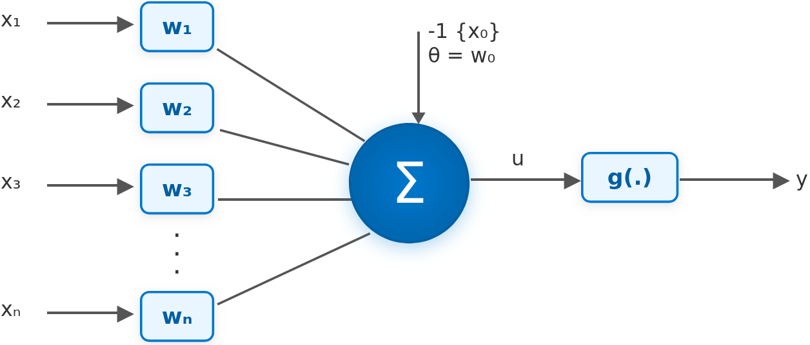
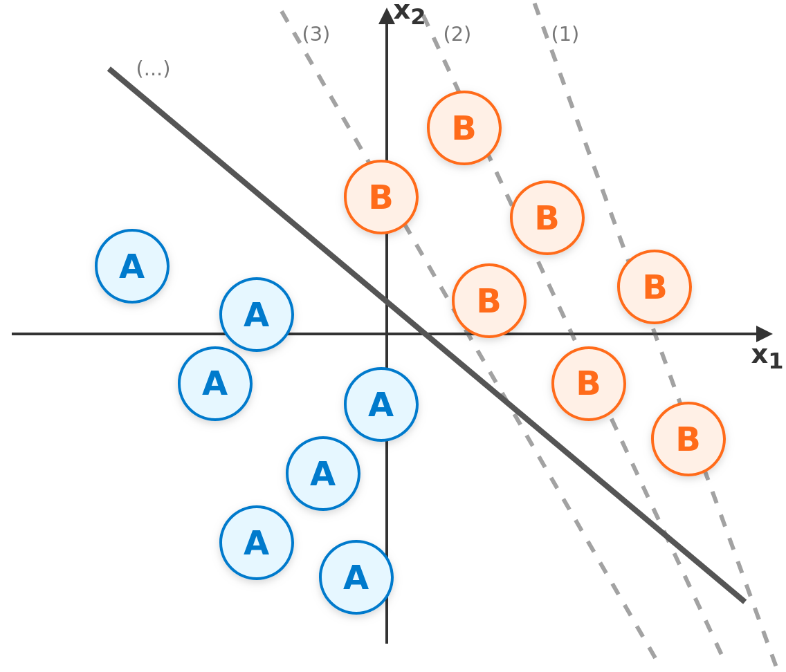
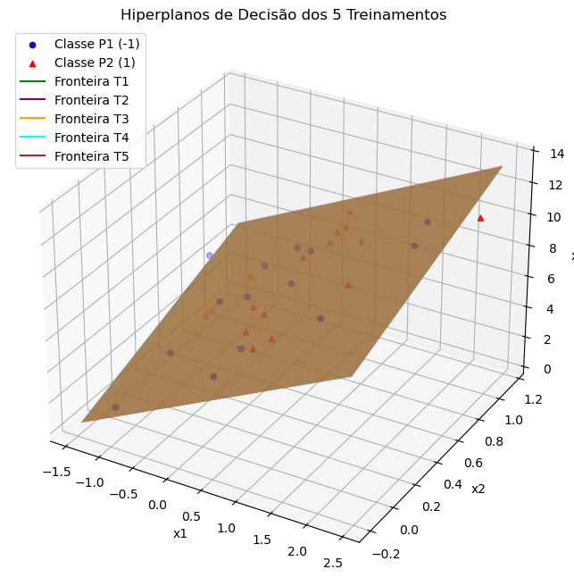
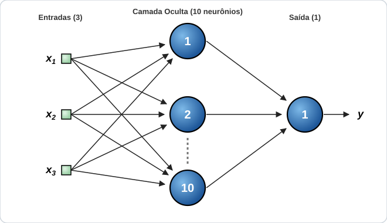
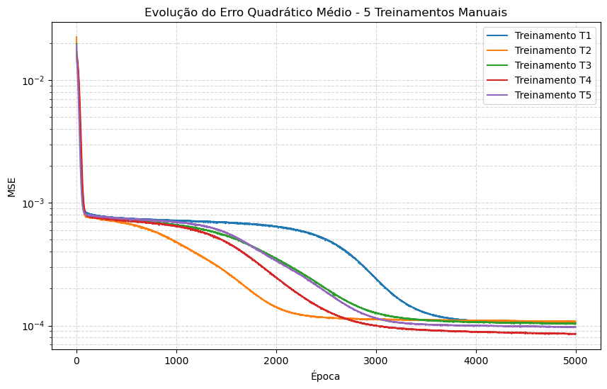
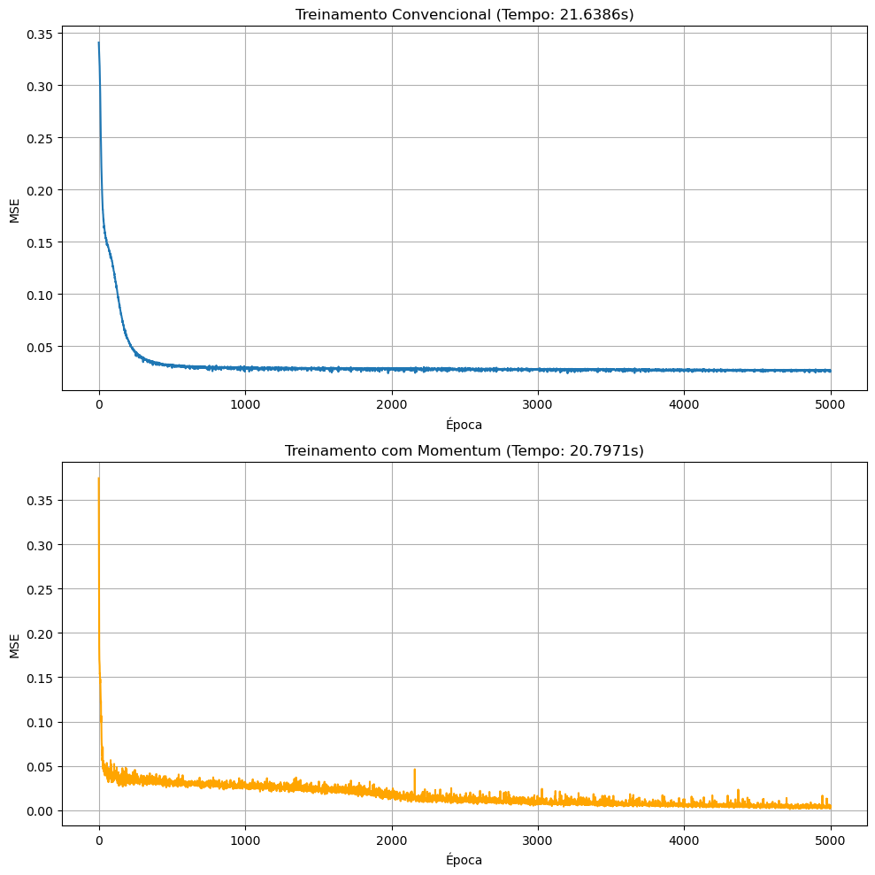
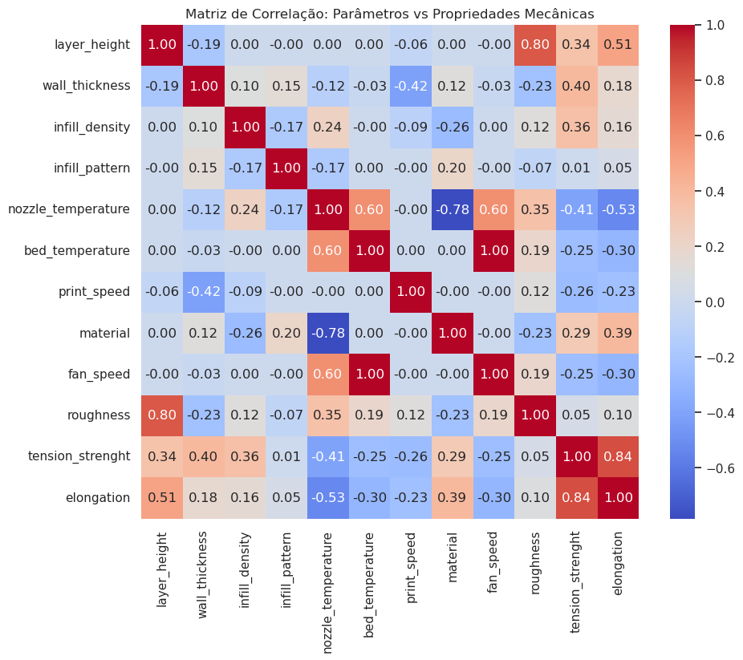

# Integração de Redes Neurais Artificiais à Engenharia — Guia Didático Completo (PID)

> 🌐 **Acesse o Portal Didático Online (GitHub Pages):** https://enzosarmento.github.io/python-rna-engenharia-didatico/
>
> **Público-alvo:** Estudantes de Engenharia (Química, Mecânica, Produção, Elétrica, Materiais, Controle e Automação) e Ciências Exatas que **nunca programaram em Python** e **nunca estudaram Redes Neurais Artificiais**, mas já dominam a base matemática da graduação (Cálculo, Álgebra Linear e Estatística Básica).

---

## Sumário Linear

1. [Visão Geral](#1-visão-geral)
2. [Instalação](#2-instalação)
3. [Estrutura de Pastas](#3-estrutura-de-pastas)
4. [Ordem de Estudo](#4-ordem-de-estudo)
5. [Teoria Simplificada (Com Analogias de Engenharia)](#5-teoria-simplificada-com-analogias-de-engenharia)
6. [Resultados e Visualizações dos Projetos](#6-resultados-e-visualizações-dos-projetos)
7. [Troubleshooting (Solução de Problemas Comuns)](#7-troubleshooting-solução-de-problemas-comuns)

---

## 1. Visão Geral

Este repositório foi desenvolvido no âmbito do **Programa de Iniciação à Docência (PID)** com uma missão clara: construir uma ponte direta, sem caixas-pretas, entre a **matemática de Engenharia** e a **Inteligência Artificial aplicada a problemas físicos e industriais**.

Na maioria dos cursos introdutórios de computação, redes neurais são apresentadas como comandos prontos de bibliotecas — você chama `.fit()`, recebe uma resposta e não sabe quais equações foram resolvidas lá dentro. Aqui adotamos a **metodologia dupla ("Caixa Aberta → Ferramenta Industrial")**:

1. **Matemática Aberta (`Python` / `NumPy` puro):** Primeiro construímos cada algoritmo linha por linha usando apenas operações vetoriais e matriciais explícitas, seguindo fielmente a formulação clássica do livro-texto *Redes Neurais Artificiais para Engenharia e Ciências Aplicadas* (Ivan Nunes da Silva, Danilo Hernane Spatti e Rogério Andrade Flauzino).
2. **Padrão da Indústria (`Scikit-Learn` e `TensorFlow/Keras`):** Em seguida, resolvemos **exatamente o mesmo problema de engenharia** com as bibliotecas profissionais usadas no mercado, comparando tempo computacional, estabilidade numérica e precisão.

### Diferenciais Pedagógicos deste Material
- **Zero pré-requisito de programação:** Começamos no módulo `00` ensinando o que é uma variável, uma lista, um laço `for` (repetição automática) e uma função `def` usando cálculos de pressão, Lei de Ohm e deformação mecânica.
- **Código comentado linha a linha:** Todo bloco de código nos **22 notebooks interativos** possui explicação conceitual antes, comentários em português em cada linha relevante e interpretação física dos resultados logo após.
- **Analogias de Engenharia:** Todo conceito novo de Aprendizado de Máquina é conectado imediatamente a sistemas físicos familiares (válvulas de controle, calibração de sensores, adimensionalização, inércia mecânica e filtros digitais).
- **Aprendizado Ativo:** Todos os notebooks terminam com **exercícios práticos** seguidos de **gabaritos ocultos** (`<details>`) para você tentar resolver antes de conferir a resposta.
- **Material de Apoio Sempre à Mão:** Consulte a qualquer momento o [**Glossário Completo (`GLOSSARIO.md`)**](GLOSSARIO.md) caso encontre algum termo técnico durante a leitura.

---

## 2. Instalação

Os arquivos interativos deste curso possuem extensão `.ipynb` (*Jupyter Notebooks* — cadernos digitais que combinam texto formatado, fórmulas matemáticas e blocos executáveis de código Python na mesma tela).

> **Nunca instalou Python, Anaconda ou VS Code?** Leia primeiro o [**Guia de Instalação Passo a Passo do Zero Absoluto (`INSTALACAO.md`)**](INSTALACAO.md), que mostra detalhadamente como preparar o ambiente no **Windows, Linux, macOS ou Google Colab** (direto no navegador, sem instalar nada).

### Resumo Rápido (Para quem já tem Python 3.10 a 3.12 instalado)

1. **Clone ou baixe este repositório** e entre na pasta raiz pelo terminal:
   ```bash
   git clone https://github.com/enzosarmento/python-rna-engenharia-didatico.git
   cd python-rna-engenharia-didatico
   ```

2. **Crie e ative um ambiente virtual isolado** (pasta local `.venv` que guarda as bibliotecas do projeto sem bagunçar o restante do seu computador):
   - **Linux / macOS:**
     ```bash
     python3 -m venv .venv
     source .venv/bin/activate
     ```
   - **Windows (PowerShell):**
     ```powershell
     python -m venv .venv
     .\.venv\Scripts\Activate.ps1
     ```

3. **Instale todas as bibliotecas necessárias** listadas em [`requirements.txt`](requirements.txt):
   ```bash
   pip install --upgrade pip
   pip install -r requirements.txt
   ```

4. **Inicie o JupyterLab** (a interface visual no navegador):
   ```bash
   jupyter lab
   ```
   Quando o navegador abrir, entre na pasta `documentacao-didatica/` pela barra lateral esquerda e dê duplo clique em `00_introducao_python_engenharia.ipynb`.

---

## 3. Estrutura de Pastas

O repositório está organizado de forma modular para separar claramente a **trilha teórica fundamental**, os **laboratórios guiados de dados** e os **projetos aplicados de Engenharia**:

```text
rna-engenharia/
├── README.md                        # Este guia enciclopédico principal
├── INSTALACAO.md                    # Passo a passo ilustrado (Anaconda, VS Code e Google Colab)
├── GLOSSARIO.md                     # Dicionário de termos técnicos traduzidos para Engenharia
├── requirements.txt                 # Lista padronizada de bibliotecas Python e suas versões
├── docs/                            # Portal estático publicado no GitHub Pages (index, notebooks, instalação, glossário)
│
├── documentacao-didatica/           # Núcleo didático principal (22 notebooks numerados)
│   ├── 00_introducao_python_engenharia.ipynb
│   ├── 01_numpy_vetores_e_matrizes.ipynb
│   ├── 02_pandas_exploracao_e_agrupamento.ipynb
│   ├── 03_pandas_limpeza_dados_reais.ipynb
│   ├── 04_visualizacao_dados.ipynb
│   ├── 05_perceptron_teoria_e_pratica.ipynb
│   ├── 06_pmc_e_backpropagation.ipynb
│   │
│   ├── arquivos-csv/                # Bases de dados tabulares (.csv) usadas nas aulas e desafios
│   ├── imagens/                     # Diagramas de topologia e gráficos dos resultados
│   │
│   ├── titanic/                     # Laboratório Guiado 1: Dados reais com ruído e lacunas
│   │   ├── README.md
│   │   ├── 01_exercicio_numpy.ipynb
│   │   ├── 02_exercicio_pandas.ipynb
│   │   ├── 03_exercicio_visualizacao.ipynb
│   │   ├── 04_desafio_titanic_parte1_perceptron.ipynb
│   │   └── 05_desafio_titanic_parte2_mlp.ipynb
│   │
│   ├── iris/                        # Laboratório Guiado 2: Classificação multiclasse (3 classes)
│   │   ├── README.md
│   │   ├── 01_desafio_iris_parte1_perceptron.ipynb
│   │   └── 02_desafio_iris_parte2_mlp.ipynb
│   │
│   └── engenharia/                  # Projetos Reais de Engenharia (Livro-Base + Indústria)
│       ├── README.md
│       ├── 01_classificacao_oleo_perceptron.ipynb
│       ├── 02_projeto1_pmc_regressao_numpy.ipynb
│       ├── 03_projeto1_comparacao_sklearn_keras.ipynb
│       ├── 04_projeto2_pmc_conservantes_numpy.ipynb
│       ├── 05_projeto2_comparacao_sklearn_keras.ipynb
│       ├── 06_projeto3_series_temporais_pmc.ipynb
│       ├── prompt-projeto-pratico-1.md
│       ├── prompt-projeto-pratico-2.md
│       ├── prompt-projeto-pratico-3.md
│       ├── topologia-aprox-funcoes.html
│       ├── datasets/                # Tabelas experimentais de treino e validação cega
│       └── impressora-3d/           # Estudo de Caso: Manufatura Aditiva (Impressão 3D FDM)
│           ├── 01_impressora3d_eda_e_classificacao_material.ipynb
│           ├── 02_impressora3d_predicao_resistencia_mecanica.ipynb
│           ├── printer_dataset.py   # Script Python modular autônomo para terminal
│           └── data.csv             # Ensaios laboratoriais reais (50 corpos de prova)
│
└── livro-base/                      # Referência bibliográfica e tabelas brutas originais
    ├── redes_neurais_artificiais_para_engenharia_e_ciencias_aplicadas[1].pdf
    └── MateriaisApêndiceIII_RNA/
```

---

## 4. Ordem de Estudo

Para aproveitar 100% do material sem lacunas de conhecimento, siga rigorosamente as **4 Etapas Lineares** abaixo. Nunca pule direto para os projetos finais sem passar pela Etapa 1!

### Etapa 1 — Fundamentos de Programação, Dados e Redes Neurais (Base Obrigatória)

| Ordem | Notebook | O que você vai aprender |
| :---: | :--- | :--- |
| **00** | [`00_introducao_python_engenharia.ipynb`](documentacao-didatica/00_introducao_python_engenharia.ipynb) | Como usar células do Jupyter, variáveis, tipos numéricos, listas, dicionários, condicionais `if/else`, laços `for`, funções `def` e classes `class` aplicadas a fórmulas de Engenharia. |
| **01** | [`01_numpy_vetores_e_matrizes.ipynb`](documentacao-didatica/01_numpy_vetores_e_matrizes.ipynb) | Vetores e matrizes (`ndarray`) no `NumPy`, *broadcasting* (cálculo vetorial em massa sem `for`), indexação matricial e resolução de sistemas lineares $A\mathbf{x} = \mathbf{b}$ (malhas elétricas e treliças). |
| **02** | [`02_pandas_exploracao_e_agrupamento.ipynb`](documentacao-didatica/02_pandas_exploracao_e_agrupamento.ipynb) | Leitura de tabelas `.csv` em `DataFrames` (planilhas programáveis do `pandas`), inspeção estatística (`head`, `info`, `describe`), filtros lógicos e agrupamentos (`groupby`). |
| **03** | [`03_pandas_limpeza_dados_reais.ipynb`](documentacao-didatica/03_pandas_limpeza_dados_reais.ipynb) | Tratamento de falhas de medição (`NaN` — dados ausentes), imputação pela média/mediana/moda, conversão de textos sujos para números e *One-Hot Encoding* (codificação binária de categorias). |
| **04** | [`04_visualizacao_dados.ipynb`](documentacao-didatica/04_visualizacao_dados.ipynb) | Anatomia de gráficos científicos (`Figure` e `Axes` no `Matplotlib` e `Seaborn`), histogramas, *boxplots* para detecção de *outliers* (valores discrepantes) e mapas de calor de correlação. |
| **05** | [`05_perceptron_teoria_e_pratica.ipynb`](documentacao-didatica/05_perceptron_teoria_e_pratica.ipynb) | O neurônio artificial de Rosenblatt: soma ponderada, pesos, viés (*bias*), função degrau, fronteira de decisão linear, treinamento passo a passo nas portas `AND`/`OR` e o limite clássico da porta `XOR`. |
| **06** | [`06_pmc_e_backpropagation.ipynb`](documentacao-didatica/06_pmc_e_backpropagation.ipynb) | Como superar problemas não lineares empilhando camadas: o **Perceptron Multicamadas (PMC / MLP)**, funções diferenciáveis (Sigmóide e ReLU), **Gradiente Descendente** e algoritmo **Backpropagation** (retropropagação do erro) resolvendo o `XOR` do zero. |

---

### Etapa 2 — Laboratório Guiado 1: Dados Reais Imperfeitos ([`titanic/`](documentacao-didatica/titanic/README.md))

Antes de modelar reatores ou ensaios mecânicos, praticamos limpeza e classificação em uma base histórica real repleta de valores faltantes e variáveis mistas:

1. [`titanic/01_exercicio_numpy.ipynb`](documentacao-didatica/titanic/01_exercicio_numpy.ipynb) — Estatística vetorial e máscaras booleanas em idades e tarifas.
2. [`titanic/02_exercicio_pandas.ipynb`](documentacao-didatica/titanic/02_exercicio_pandas.ipynb) — Taxas de sobrevivência por classe e exportação de relatórios `.csv`.
3. [`titanic/03_exercicio_visualizacao.ipynb`](documentacao-didatica/titanic/03_exercicio_visualizacao.ipynb) — Investigação visual multivariada de sobrevivência.
4. [`titanic/04_desafio_titanic_parte1_perceptron.ipynb`](documentacao-didatica/titanic/04_desafio_titanic_parte1_perceptron.ipynb) — Pré-processamento completo sem **vazamento de dados** (*Data Leakage* — erro de usar dados de teste na calibração) e classificação linear com Perceptron (Python puro vs. `Scikit-Learn`).
5. [`titanic/05_desafio_titanic_parte2_mlp.ipynb`](documentacao-didatica/titanic/05_desafio_titanic_parte2_mlp.ipynb) — Evolução para rede multicamadas (PMC/MLP) capturando interações não lineares entre classe, sexo e idade.

---

### Etapa 3 — Laboratório Guiado 2: Classificação Multiclasse ([`iris/`](documentacao-didatica/iris/README.md))

Como classificar amostras quando há **3 ou mais categorias simultâneas** em vez de apenas "sim/não"?

1. [`iris/01_desafio_iris_parte1_perceptron.ipynb`](documentacao-didatica/iris/01_desafio_iris_parte1_perceptron.ipynb) — Estratégia *One-vs-Rest* (Um-contra-Todos: um neurônio especialista para cada classe) e diagnóstico visual de onde o modelo linear esbarra na fronteira curva entre duas espécies.
2. [`iris/02_desafio_iris_parte2_mlp.ipynb`](documentacao-didatica/iris/02_desafio_iris_parte2_mlp.ipynb) — Rede PMC com saída vetorial *One-Hot* (`[1,0,0]`, `[0,1,0]`, `[0,0,1]`) e função `Softmax` (conversão das saídas em probabilidades que somam 100%).

---

### Etapa 4 — Projetos Aplicados de Engenharia ([`engenharia/`](documentacao-didatica/engenharia/README.md))

Aqui aplicamos todo o ferramental em **5 problemas concretos de diferentes ramos da Engenharia**:

| Projeto | Área da Engenharia | Notebooks e Especificações | Conceito-Chave |
| :--- | :--- | :--- | :--- |
| **Óleo Isolante / Lubrificante** | Química e Petróleo | [`01_classificacao_oleo_perceptron.ipynb`](documentacao-didatica/engenharia/01_classificacao_oleo_perceptron.ipynb) | Classificação de pureza (`P1`/`P2`) em 3D e múltiplos hiperplanos separadores conforme a semente inicial de pesos. |
| **Projeto Prático 1 — Ressonância Magnética** | Biomédica e Elétrica | [`02_projeto1_pmc_regressao_numpy.ipynb`](documentacao-didatica/engenharia/02_projeto1_pmc_regressao_numpy.ipynb)<br>[`03_projeto1_comparacao_sklearn_keras.ipynb`](documentacao-didatica/engenharia/03_projeto1_comparacao_sklearn_keras.ipynb)<br>*(Ref: [`prompt-projeto-pratico-1.md`](documentacao-didatica/engenharia/prompt-projeto-pratico-1.md))* | **Regressão não linear** (aproximação universal de funções contínuas) com rede `3-10-1`, erro relativo percentual e variância entre mínimos locais. |
| **Projeto Prático 2 — Conservantes** | Alimentos e Processos Químicos | [`04_projeto2_pmc_conservantes_numpy.ipynb`](documentacao-didatica/engenharia/04_projeto2_pmc_conservantes_numpy.ipynb)<br>[`05_projeto2_comparacao_sklearn_keras.ipynb`](documentacao-didatica/engenharia/05_projeto2_comparacao_sklearn_keras.ipynb)<br>*(Ref: [`prompt-projeto-pratico-2.md`](documentacao-didatica/engenharia/prompt-projeto-pratico-2.md))* | Classificação multiclasse (`A`, `B`, `C`) em rede `4-15-3` demonstrando na prática a aceleração drástica do termo de **Momentum** ($\alpha = 0{,}9$). |
| **Projeto Prático 3 — Séries Temporais** | Controle, Automação e Produção | [`06_projeto3_series_temporais_pmc.ipynb`](documentacao-didatica/engenharia/06_projeto3_series_temporais_pmc.ipynb)<br>*(Ref: [`prompt-projeto-pratico-3.md`](documentacao-didatica/engenharia/prompt-projeto-pratico-3.md))* | Predição dinâmica futura ($t = 101 \dots 120$) com **TDNN** (*Time-Delay Neural Network* — rede alimentada por janela deslizante de atrasos no tempo). |
| **Estudo de Caso — Impressão 3D FDM** | Mecânica e Materiais | [`impressora-3d/01_impressora3d_eda_e_classificacao_material.ipynb`](documentacao-didatica/engenharia/impressora-3d/01_impressora3d_eda_e_classificacao_material.ipynb)<br>[`impressora-3d/02_impressora3d_predicao_resistencia_mecanica.ipynb`](documentacao-didatica/engenharia/impressora-3d/02_impressora3d_predicao_resistencia_mecanica.ipynb)<br>[`impressora-3d/printer_dataset.py`](documentacao-didatica/engenharia/impressora-3d/printer_dataset.py) | Termodinâmica da manufatura aditiva (`ABS` vs. `PLA`), predição de resistência à tração (MPa) em pequenas amostras ($N=50$) e **Gêmeos Digitais**. |

---

## 5. Teoria Simplificada (Com Analogias de Engenharia)

Se você entende como calibrar um instrumento de bancada ou ajustar válvulas em uma planta piloto, você já domina a intuição física de uma Rede Neural Artificial. Veja a tradução direta:

### 5.1. O Neurônio Artificial como uma Estação de Mistura com Válvulas

Um neurônio recebe grandezas medidas pelos sensores ($x_1, x_2, \dots, x_n$), multiplica cada uma por um **peso sináptico** ($w_1, w_2, \dots, w_n$) e desconta um **limiar de ativação** ($\theta$, também chamado de **viés** ou *bias*), gerando o potencial interno $u$:

$$u = \sum_{i=1}^{n} w_i x_i - \theta$$

- **Pesos ($w_i$) $\approx$ Grau de abertura de válvulas:** Se $w_1$ é grande e positivo, a variável $x_1$ tem passagem franca e forte impacto positivo no resultado; se $w_2 \approx 0$, a válvula está quase fechada (aquela variável é irrelevante para o fenômeno); se $w_3 < 0$, atua como efeito inibidor.
- **Viés / *Bias* ($\theta$) $\approx$ Parafuso de *offset* (ajuste de zero) de um manômetro:** Sem o termo constante $\theta$, toda reta ou plano separador seria obrigado a cruzar a origem $(0, 0, \dots, 0)$. O viés permite transladar a fronteira de decisão para a faixa real de operação do processo.
- **Função de Ativação $g(u)$ $\approx$ Elemento atuador de saída:**
  - No **Perceptron Simples**, $g(u)$ é uma **função degrau** (como um *pressostato* ou *termostato on/off* que dispara `+1` acima do limite e `-1` abaixo dele). Por isso, um único Perceptron só resolve problemas **linearmente separáveis** (onde uma reta em 2D ou um plano reto em 3D separa totalmente as classes).
  - No **Perceptron Multicamadas (PMC / MLP)**, trocamos o degrau brusco por curvas suaves e deriváveis — como a **Sigmóide Logística** $\sigma(u) = \frac{1}{1 + e^{-u}}$ (válvula proporcional contínua entre `0` e `1`) ou a **ReLU** $\max(0, u)$ (análoga a um diodo retificador ideal que bloqueia sinais negativos e conduz positivos).

### 5.2. Normalização de Dados $\approx$ Adimensionalização

Em Engenharia, nunca somamos diretamente a temperatura do bico extrusor (`240 °C`) com a altura de camada (`0,06 mm`) sem considerar suas ordens de grandeza — caso contrário, `240` esmagaria numericamente `0,06` e saturaria exponenciais como $e^{-u}$.

Por isso aplicamos **Normalização Min-Max** (reescalonando tudo para `[0, 1]`) ou **Padronização Z-score** ($z = \frac{x - \mu}{\sigma}$, deixando média zero e desvio padrão unitário). **Regra de ouro contra Vazamento de Dados (*Data Leakage*):** a média $\mu$ e o desvio $\sigma$ devem ser calculados **exclusivamente no conjunto de treino** e apenas reaplicados nas amostras inéditas de teste!

### 5.3. Treinamento, Gradiente Descendente, Backpropagation e Momentum

"Treinar" uma rede neural nada mais é do que resolver um **problema de otimização numérica**: encontrar o conjunto de abertura das válvulas ($\mathbf{W}$) que minimiza o **Erro Quadrático Médio** (*MSE — Mean Squared Error*, média dos quadrados das diferenças entre o valor medido em laboratório $d$ e o valor previsto pela rede $y$):

$$E_M = \frac{1}{N} \sum_{k=1}^{N} \frac{1}{2}\big(d^{(k)} - y^{(k)}\big)^2$$

1. **Propagação Direta (*Forward Pass*):** Os dados entram pelos sensores, atravessam as camadas ocultas e geram um chute inicial $y$. Medimos o erro na saída ($e = d - y$).
2. **Retropropagação do Erro (*Backpropagation*):** Como descobrir qual válvula da camada intermediária causou o erro lá na ponta final? Aplicamos a **Regra da Cadeia do Cálculo Diferencial** de trás para frente, distribuindo proporcionalmente a "parcela de responsabilidade" (gradiente local $\delta$) para cada neurônio oculto.
3. **Gradiente Descendente (*Gradient Descent*):** Sabendo a inclinação da superfície de erro ($\nabla E$), damos um passo no sentido oposto ao gradiente (sentido de maior descida), controlado pela **taxa de aprendizado** $\eta$ (*learning rate* — tamanho do passo):
   - $\eta$ muito pequeno $\rightarrow$ descida segura, porém lentíssima (milhares de **épocas**, isto é, passagens completas pela tabela de treino).
   - $\eta$ exagerado $\rightarrow$ passos largos demais que ricocheteiam nas paredes do vale e fazem o erro divergir.
4. **Termo de *Momentum* ($\alpha$) $\approx$ Inércia Mecânica:** Imagine substituir uma bolinha de isopor sem massa por uma **esfera pesada de aço** rolando encosta abaixo. Ao somar uma fração $\alpha$ (ex.: `0.8` ou `0.9`) do passo anterior ao passo atual ($\Delta w(t) = \eta \delta x + \alpha \Delta w(t-1)$), a esfera ganha embalo em rampas constantes e atravessa pequenas oscilações sem travar!
5. **Janelas de Atraso no Tempo (TDNN) $\approx$ Filtro Digital FIR:** Redes estáticas não possuem memória própria. Para prever o próximo ponto $x(t)$ de uma vibração ou série temporal, alimentamos a entrada da rede com um vetor de leituras passadas $[x(t-1), x(t-2), \dots, x(t-p)]$, transformando um problema dinâmico em um mapeamento supervisionado de janela deslizante.

---

## 6. Resultados e Visualizações dos Projetos

Abaixo estão os principais resultados gráficos obtidos ao longo da trilha didática, ilustrando na prática a evolução do neurônio simples até redes multicamadas aplicadas à indústria.

### 6.1. Do Neurônio Simples à Evolução da Fronteira Linear

No módulo [`05_perceptron_teoria_e_pratica.ipynb`](documentacao-didatica/05_perceptron_teoria_e_pratica.ipynb), estudamos a estrutura interna do Perceptron e acompanhamos época a época como a reta de decisão gira e se desloca à medida que a regra de aprendizado corrige os erros:

<p align="center">
  
</p>

<p align="center">
  
</p>

---

### 6.2. Classificação Tridimensional de Amostras de Óleo (Perceptron em $\mathbb{R}^3$)

No projeto [`01_classificacao_oleo_perceptron.ipynb`](documentacao-didatica/engenharia/01_classificacao_oleo_perceptron.ipynb), três propriedades físico-químicas ($x_1, x_2, x_3$) definem um espaço tridimensional onde a fronteira $w_1 x_1 + w_2 x_2 + w_3 x_3 - \theta = 0$ deixa de ser uma reta e passa a ser um **plano separador**. Executando 5 treinamentos com pesos iniciais aleatórios diferentes, comprovamos geometricamente que todos atingem `100%` de acerto no treino, mas convergem para **planos ligeiramente distintos** (pois existem infinitos cortes planos possíveis no corredor vazio entre duas nuvens linearmente separáveis):

<p align="center">
  
</p>

---

### 6.3. Projeto Prático 1 — Regressão Não Linear com PMC `3-10-1` (Ressonância Magnética)

Nos notebooks [`02_projeto1_pmc_regressao_numpy.ipynb`](documentacao-didatica/engenharia/02_projeto1_pmc_regressao_numpy.ipynb) e [`03_projeto1_comparacao_sklearn_keras.ipynb`](documentacao-didatica/engenharia/03_projeto1_comparacao_sklearn_keras.ipynb), utilizamos uma arquitetura **Perceptron Multicamadas `3-10-1`** (3 sensores de entrada, 10 neurônios ocultos sigmóides e 1 saída contínua) para estimar a energia absorvida por pacientes em exames de Ressonância Magnética:

<p align="center">
  
</p>

O treinamento via *Backpropagation* reduz o Erro Quadrático Médio ($E_M$) assintoticamente até atingir a precisão exigida de $\varepsilon = 10^{-6}$, alcançando **erro relativo médio em torno de `1%`** nas 20 amostras cegas de validação clínica:

<p align="center">
  
</p>

---

### 6.4. Projeto Prático 2 — O Efeito da Inércia (*Momentum*) na Classificação de Conservantes

No notebook [`04_projeto2_pmc_conservantes_numpy.ipynb`](documentacao-didatica/engenharia/04_projeto2_pmc_conservantes_numpy.ipynb), comparamos em igualdade de condições (mesmos pesos iniciais!) o algoritmo *Backpropagation* convencional ($\alpha = 0$) contra o *Backpropagation* com **Momentum** ($\alpha = 0{,}9$) na classificação química de três conservantes (`A`, `B`, `C`). O resultado experimental confirma a teoria: a inércia reduz drasticamente o número de épocas necessárias para convergir à tolerância $\varepsilon = 10^{-6}$, economizando mais de **80% do tempo computacional**:

<p align="center">
  
</p>

---

### 6.5. Estudo de Caso Industrial — Termodinâmica e Resistência Mecânica em Impressão 3D

Nos notebooks da pasta [`impressora-3d/`](documentacao-didatica/engenharia/impressora-3d/01_impressora3d_eda_e_classificacao_material.ipynb), analisamos 50 corpos de prova fabricados por manufatura aditiva FDM. A matriz de correlação abaixo revela imediatamente as relações físicas do processo (como o acoplamento entre temperatura do bico extrusor, taxa de ventilação e retração térmica do polímero, além da forte influência do preenchimento interno e da espessura de parede na resistência final à tração em MPa):

<p align="center">
  
</p>

---

## 7. Troubleshooting (Solução de Problemas Comuns)

Se aparecer uma mensagem de erro com fundo vermelho ao executar uma célula no Jupyter, **não se assuste!** Erros em Python são diagnósticos objetivos que dizem na **última linha** exatamente o que aconteceu. Consulte a tabela rápida abaixo:

| Erro Exibido na Tela | Causa Mais Provável | Como Resolver Imediatamente |
| :--- | :--- | :--- |
| **`ModuleNotFoundError: No module named 'numpy'`** *(ou `'pandas'`, `'seaborn'`, `'sklearn'`, `'tensorflow'`)* | As bibliotecas não foram instaladas ou o Jupyter/VS Code está conectado a um ambiente Python diferente daquele onde você rodou o `pip install`. | No terminal (com o ambiente virtual ativo), rode `pip install -r requirements.txt`. No canto superior direito do notebook (VS Code / JupyterLab), clique no seletor de **Kernel** e escolha `.venv` ou `base (Anaconda)`. |
| **`FileNotFoundError: [Errno 2] No such file or directory: '...csv'`** | O diretório de trabalho atual do notebook foi alterado ou você moveu o arquivo `.ipynb` de pasta sem mover a pasta de dados correspondente. | Mantenha a estrutura original de pastas do repositório. Todos os notebooks já usam **caminhos relativos testados** a partir de sua própria pasta (ex.: `../arquivos-csv/titanic.csv` ou `datasets/projeto-pratico-1.csv`). Se abriu no **Google Colab**, confira a seção Colab do [`INSTALACAO.md`](INSTALACAO.md). |
| **`NameError: name 'df' is not defined`** *(ou `'np' is not defined`, `'X_train' is not defined`)* | Você executou uma célula no meio do notebook **sem ter executado as células anteriores** (ou reabriu o notebook hoje e tentou continuar da metade — a memória RAM zera quando o notebook é fechado!). | No menu superior do JupyterLab / VS Code, clique em **`Kernel` → `Restart Kernel and Run All Cells`** (Reiniciar e Executar Tudo de cima para baixo). |
| **`ValueError: shapes (m, n) and (p, q) not aligned`** | Incompatibilidade dimensional na multiplicação matricial (`@` ou `np.dot`): o número de colunas da primeira matriz ($n$) precisa ser igual ao número de linhas da segunda ($p$). | Imprima `print(A.shape, B.shape)` antes da conta para inspecionar as dimensões e use a transposta `.T` quando necessário (ex.: `X @ W.T`). |
| **`ValueError: could not convert string to float`** / Resultado dando **`nan`** | A tabela ainda contém textos (`'male'`, `'abs'`, vírgula decimal `'3,14'`) ou valores vazios (`NaN`) sendo enviados direto para contas matriciais, ou a taxa de aprendizado $\eta$ foi alta demais e explodiu as exponenciais. | Revise as etapas de limpeza do módulo [`03_pandas_limpeza_dados_reais.ipynb`](documentacao-didatica/03_pandas_limpeza_dados_reais.ipynb) (`dropna`/`fillna`, codificação numérica e normalização) e reduza $\eta$ (ex.: de `1.0` para `0.05`). |
| **`SyntaxError` ou `IndentationError`** | Faltou fechar algum parêntese `)`, colchete `]`, aspas `"` ou dois-pontos `:` após um `if`/`for`/`def`, ou o recuo de espaços à esquerda ficou desalinhado. | Confira a linha apontada pela seta `^` no erro e alinhe todos os blocos internos com **4 espaços** (tecla `Tab`). |
| **Célula travada com asterisco `[*]` eterno** | Um laço `while` entrou em repetição infinita (por exemplo, critério de parada impossível em um problema não linearmente separável) ou um treinamento pesado ainda está rodando. | Clique no botão quadrado **`Stop` (Interromper Kernel)** na barra superior do Jupyter. Se precisar limpar tudo e recomeçar limpo, use **`Kernel` → `Restart Kernel`**. |

---

## Referência Bibliográfica Base

- **SILVA, Ivan Nunes da; SPATTI, Danilo Hernane; FLAUZINO, Rogério Andrade.** *Redes Neurais Artificiais para Engenharia e Ciências Aplicadas: Curso Prático*. São Paulo: Artliber Editora. *(Exemplar de referência e tabelas brutas disponíveis na pasta [`livro-base/`](livro-base/)).*
